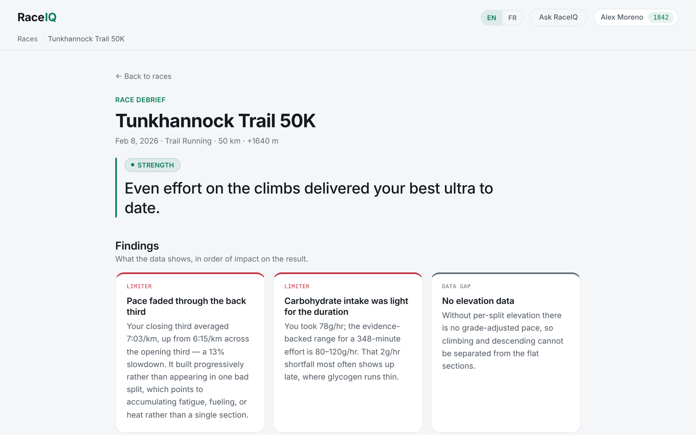
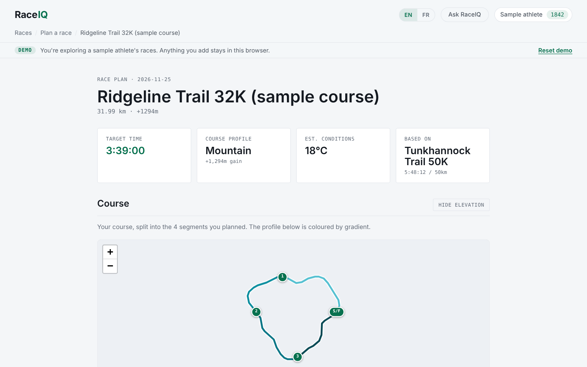

# RaceIQ

**Race intelligence for runners and cyclists: every race, and the story behind the result.**

RaceIQ turns race files into a debrief you can act on. It explains *why* a race went the way it did (pacing, climbing, heat, fueling), then uses your history to plan the next one: pacing by section, nutrition targets, aid-station carry plans and a printable crew sheet. An AI coach answers questions about your races, grounded only in numbers the analysis engine already computed.


## What it does

- **Race debrief.** Splits are analyzed for fade, pacing discipline and grade-adjusted pace (a Minetti-derived energy cost curve), then cross-checked against conditions and fueling. Findings are ranked by impact on the result and labeled as a strength, a limiter or a data gap.
- **Race planning.** Upload a course GPX or TCX and RaceIQ builds a pacing strategy and nutrition plan from your past results. Aid stations are read straight from the file's waypoints, which drive the carry plan between stations, drop bags and crew timings. Plans export to PDF.
- **Ask RaceIQ.** A coach you can question about your own races ("why did I fade at Tunkhannock?"). It cites which race each claim comes from and declines medical or training-plan questions.
- **Weather.** Historical race-day conditions from Open-Meteo, so heat and humidity are part of the analysis.
- **English and French**, end to end, including AI responses.



## How the AI is kept honest

The design choice I care most about: **Claude never produces the numbers.**

- A deterministic engine (`src/utils/analysis.js`, `pace.js`, `fueling.js`) computes every statistic. The UI and the AI read the same output.
- Claude's job is to narrate and prioritize those findings. Every system prompt carries grounding rules: cite only numbers present in the data block, name the race behind every claim, decline medical and training-plan requests.
- Prompts live server-side (`api/_lib/prompts.js`). The browser sends race data, never prompt text, so a client cannot rewrite the instructions.
- Questions are classified by intent first, so the model only receives the data relevant to the question. Medical and training-plan questions are refused deterministically, without a model call.

## Architecture

```
Browser (React + Vite)
  ├── analysis engine (src/utils)  ← same code the API reuses
  ├── Supabase auth + profiles     ← row-level security, anon key only
  └── POST /api/claude             ← single serverless endpoint
          ├── verifies the Supabase session
          ├── per-user rate limit
          ├── builds grounded prompts server-side
          └── Anthropic API (key never reaches the client)
```

- **Frontend:** React 18, Vite, Leaflet for course maps, i18next.
- **Backend:** one serverless function on Vercel. Auth, rate limiting and error shaping live in one place; errors come back as translation keys so they render in the athlete's language.
- **Data:** Supabase (Postgres) with row-level security for profiles and races. Without Supabase configured, the app runs fully local on `localStorage`.

## Engineering notes

- **Design docs before code.** Larger features start as a written design: problem, options, decision. See [`docs/`](docs/), e.g. [GPX waypoint parsing](docs/design-gpx-waypoints.md) and [auth and athlete profiles](docs/design-auth-and-profiles.md).
- **Tests against real-world messiness.** The GPX parser is tested against fixtures for noisy elevation, route-only files, out-and-back courses, off-course waypoints and French-language aid stations (`npm test`).
- **i18n is enforced at build time.** `npm run build` fails if any English key is missing its French translation.



## Run it locally

Requires Node.js 18+.

```bash
npm install
npm run dev        # http://localhost:5173
```

With no environment variables set, RaceIQ runs in local mode with sample races and stores data in your browser. To enable accounts and the AI coach, copy `.env.example` to `.env.local` and fill in your Supabase project and Anthropic API key. The comments in that file explain which keys are client-side and which must stay server-side.

```bash
npm run build           # i18n check + production bundle
npm test                # Vitest: engine, GPX parser, demo budget
npm run check:i18n      # translation coverage only
```

## Project structure

```
api/              serverless endpoint and server-side prompt logic
src/components/   React UI (debrief, planning, coach, maps, charts)
src/utils/        analysis engine: pacing, GAP, fueling, GPX, weather, PDFs
src/i18n/         English and French resources, shared with the server
supabase/         database migrations
docs/             design docs
scripts/          i18n check, parser tests, API smoke test
```
