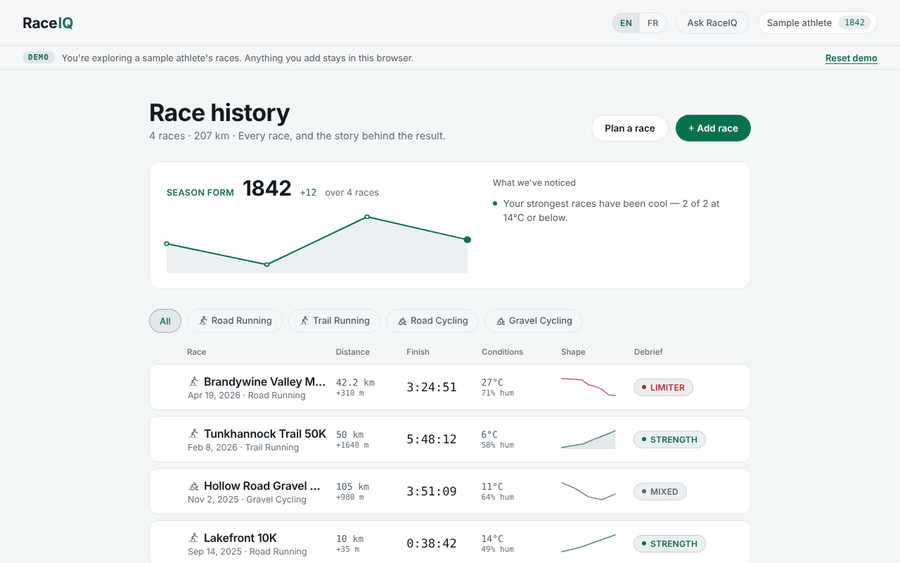
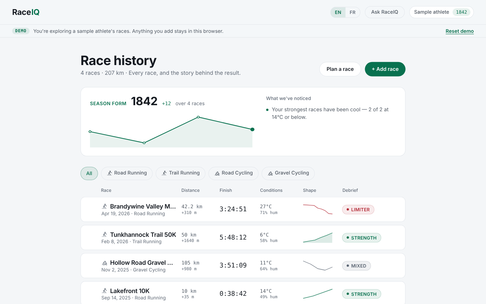
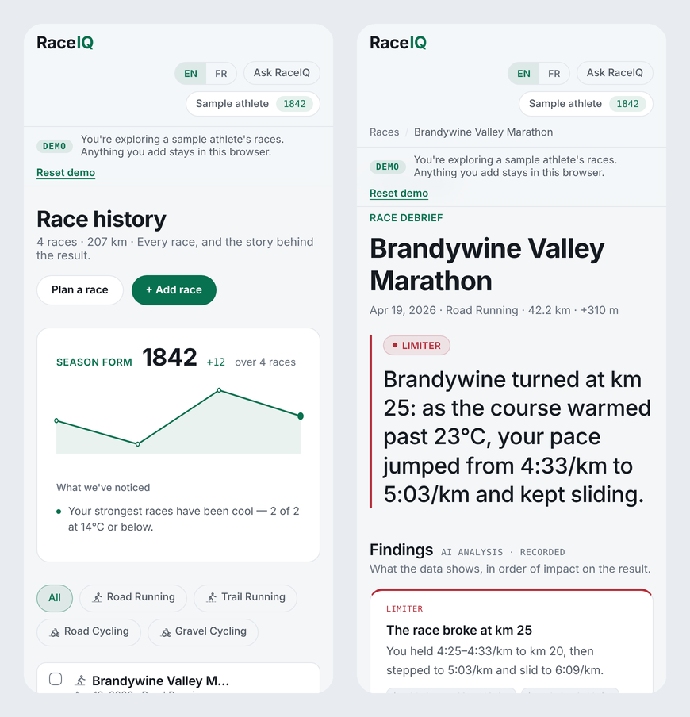
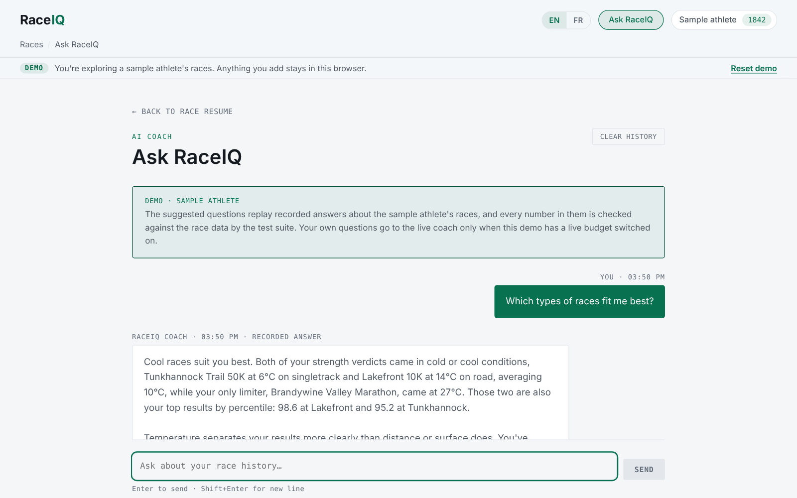

# RaceIQ

[](https://github.com/nzhang05/raceiq-app/actions/workflows/ci.yml)

**Race intelligence for runners and cyclists: every race, and the story behind the result.**

**▶ Live demo:** _link coming soon_ <!-- Replace with the Vercel URL once deployed (docs/deploy.md). --> — a sample athlete's races, no sign-up.



RaceIQ turns race files into a debrief you can act on. It explains *why* a race went the way it did (pacing, climbing, heat, fueling), then uses your history to plan the next one: pacing by section, nutrition targets, aid-station carry plans and a printable crew sheet. An AI coach answers questions about your races, grounded only in numbers the analysis engine already computed.



## What it does

- **Race debrief.** Splits are analyzed for fade, pacing discipline and grade-adjusted pace (a Minetti-derived energy cost curve), then cross-checked against conditions and fueling. Findings are ranked by impact on the result and labeled as a strength, a limiter or a data gap.
- **Race planning.** Upload a course GPX or TCX and RaceIQ builds a pacing strategy and nutrition plan from your past results. Aid stations are read straight from the file's waypoints, which drive the carry plan between stations, drop bags and crew timings. Plans export to PDF.
- **Ask RaceIQ.** A coach you can question about your own races ("why did I fade at Tunkhannock?"). It cites which race each claim comes from and declines medical or training-plan questions.
- **Weather.** Historical race-day conditions from Open-Meteo, so heat and humidity are part of the analysis.
- **English and French**, end to end, including AI responses.
- **Works on a phone.** Every view is checked at 390px wide, and the accessibility pass (labels, focus, contrast) comes back clean in axe-core.


<p align="center"></p>

## How the AI is kept honest

The design choice I care most about: **Claude never produces the numbers.**

- A deterministic engine (`src/utils/analysis.js`, `pace.js`, `fueling.js`) computes every statistic. The UI and the AI read the same output.
- Claude's job is to narrate and prioritize those findings. Every system prompt carries grounding rules: cite only numbers present in the data block, name the race behind every claim, decline medical and training-plan requests.
- Prompts live server-side (`api/_lib/prompts.js`). The browser sends race data, never prompt text, so a client cannot rewrite the instructions.
- Questions are classified by intent first, so the model only receives the data relevant to the question. Medical and training-plan questions are refused deterministically, without a model call.
- **And it's tested.** A [grounding check](docs/design-grounding-check.md) extracts every number from an AI answer and fails the build if it isn't in the data block the model was given. It runs through the real server handlers, with only the Anthropic SDK mocked, over every recorded demo answer and a set of awkward fixture races. Planted fake numbers prove it catches what it should. (It checks numbers, not attribution: a real number cited for the wrong thing would pass, and a test pins that limit.)



## Architecture

```
Browser (React + Vite)
  ├── analysis engine (src/utils)  ← same code the API reuses
  ├── Supabase auth + profiles     ← row-level security, anon key only
  └── POST /api/claude             ← single serverless endpoint
          ├── verifies the Supabase session (or, on the demo, a small
          │   per-visitor budget that defaults to zero)
          ├── per-user rate limit
          ├── builds grounded prompts server-side
          └── Anthropic API (key never reaches the client)
```

- **Frontend:** React 18, Vite, Leaflet for course maps, i18next.
- **Backend:** one serverless function on Vercel. Auth, rate limiting and error shaping live in one place; errors come back as translation keys so they render in the athlete's language.
- **Data:** Supabase (Postgres) with row-level security for profiles and races. Without Supabase configured, the app runs fully local on `localStorage`.

## Engineering notes

- **Design docs before code.** Larger features start as a written design: problem, options, decision. See [`docs/`](docs/), e.g. [GPX waypoint parsing](docs/design-gpx-waypoints.md) and [auth and athlete profiles](docs/design-auth-and-profiles.md).
- **Tests against real-world messiness.** The GPX parser is tested against fixtures for noisy elevation, route-only files, out-and-back courses, off-course waypoints and French-language aid stations.
- **i18n is enforced at build time.** `npm run build` fails if any English key is missing its French translation.
- **CI on every PR**: translation check, the full test suite, and both production builds (regular and demo).


## Testing

```bash
npm test               # everything below, ~10s, no browser and no network
npm run test:watch     # re-run on save
```

| Suite | What it pins down |
|---|---|
| `pace`, `analysis`, `fueling`, `carryPlan`, `clock` | The engine: Minetti grade-adjusted pace, fade (last third vs first) and least-squares drift, verdicts and the heat threshold, carbohydrate bands at every boundary, fueling precedence (manual > history > research), the aid-station carry plan. Also that each sample race's label matches what the engine derives. |
| `waypoints` | GPX/TCX parsing and aid-station detection on real-world-shaped files, in jsdom. |
| `grounding` | **Every number an AI answer cites must be in its data block.** Runs the real handlers with the SDK mocked over all 16 recorded demo answers and the fixture races. Planted errors must be caught exactly. It also checks that data blocks never leak `undefined` or `null`, that intent routing works (including the medical refusal), and that EN/FR route alike. |
| `RacePlanForm` | Characterization tests that drive the real planning form and snapshot the plan it builds. |
| `replay`, `demo` | Demo replay rules and the anonymous AI budget. |

Two scripts call the live model and need `ANTHROPIC_API_KEY` in `.env.local`:

```bash
npm run eval:grounding   # the grounding check against real model output (~30 calls)
npm run record:demo      # re-record the demo's AI answers, then run npm test
```

## Run it locally

Requires Node.js 20+.

```bash
npm install
npm run dev        # http://localhost:5173
```

With no environment variables set, RaceIQ runs in local mode with sample races and stores data in your browser. To enable accounts and the AI coach, copy `.env.example` to `.env.local` and fill in your Supabase project and Anthropic API key. The comments in that file explain which keys are client-side and which must stay server-side.

```bash
npm run dev:demo        # the public demo build: sample athlete, recorded AI answers
npm run build           # i18n check + production bundle
npm run check:i18n      # translation coverage only
```

To try the planner, upload [`public/sample-course.gpx`](public/sample-course.gpx), a fictional 32 km trail loop with three aid stations. Deploying the demo or the full app is covered step by step in [`docs/deploy.md`](docs/deploy.md).

## Project structure

```
api/                serverless endpoint, server-side prompts, demo budget
src/components/     React UI (debrief, planning, coach, maps, charts)
  racePlan/         the planning form, one file per section
src/utils/          analysis engine: pacing, GAP, fueling, GPX, weather, PDFs,
                    and the grounding check
src/demo/           demo replay and recorded AI answers
src/i18n/           English and French resources, shared with the server
src/__tests__/      Vitest suites;  src/__fixtures__/  GPX files, races, answers
supabase/           database migrations
docs/               design docs and deploy guide
scripts/            i18n check, API smoke test, demo recorder, live grounding eval
```
